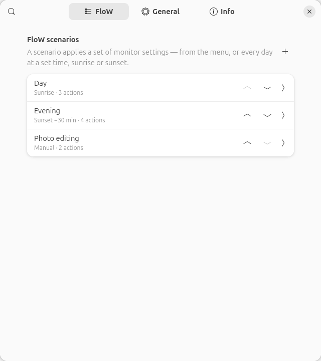
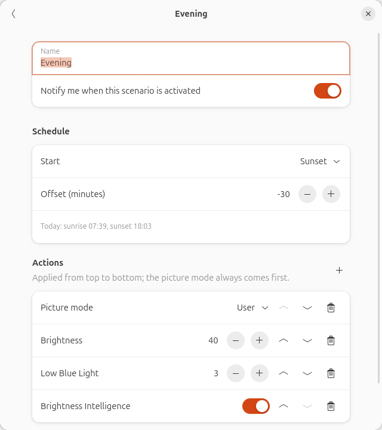
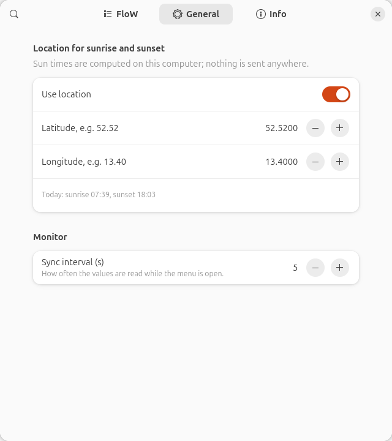

# BenQ Monitor Control for GNOME

A GNOME Shell extension that controls the **BenQ MA320U** over DDC/CI from the top bar:
picture modes, brightness, volume, input source, Low Blue Light, Brightness Intelligence,
and **FloW scenarios**, which are named sets of monitor settings that apply by hand or on
a daily schedule (fixed time, sunrise or sunset). The laptop's **brightness keys** change
the monitor too.

**Why this exists:** the MA320U's on-screen menu only offers brightness, input and volume.
Its picture modes and eye-care settings can be reached only through BenQ's *Display Pilot 2*
software. Display Pilot 2 has a Linux build, but it does not support the MA series
(`monitor does not support: "MA320U"`). This extension provides that control on GNOME.

It is the GNOME port of [benq-monitor-control](https://github.com/chrisOTM/benq-monitor-control),
a tray app for KDE Plasma. Both use the same VCP map, safety rules and scenario format.

**Status:** v0.2.0. Tested on one MA320U (USB-C) with GNOME Shell 50 on Wayland
(Ubuntu 26.04).

  
  

## Features

### Top-bar menu

| Section | What it does |
|---|---|
| Status | Connection state, I²C bus and firmware level; *Detect again* when the monitor is not found. |
| Picture mode | Tux-Book (BenQ: M-Book), sRGB, Display P3, Cinema, Game, User. Shows *HDR signal active* when the monitor receives HDR. |
| Picture & sound | Brightness (0–100) and volume (0–50) sliders. |
| Eye care | Low Blue Light (Off, 1–5) and Brightness Intelligence. |
| Input | USB-C, HDMI 1, HDMI 2. Switching asks for confirmation, because the monitor will show another device. The extension keeps its connection, the menu shows the new input and can switch back. |
| FloW | The scenarios; the active one is ticked and the header shows until when it applies. |

The menu stays open while you change things, so you see each change take effect. Controls
the monitor refuses in the current picture mode are greyed out. Low Blue Light, for example,
is locked in sRGB and Display P3, and an HDR signal locks picture mode, brightness and the
eye-care settings. After a rejected write the extension re-reads all values; if the value
arrived anyway, it counts as applied. A control is locked only after the second rejection in
a row, and the control then snaps back. Such a learned lock is forgotten after 10 minutes,
when the menu is opened, or with *Detect again*. The static locks (Low Blue Light in sRGB and
Display P3, HDR) stay. If the monitor refuses a single value of a slider, the next value in
the same direction is written instead: with Brightness Intelligence on, the MA320U refuses
brightness 70 but accepts 69 and 71.

**Brightness Intelligence** is BenQ's automatic brightness. The MA320U has a built-in
ambient light sensor and adjusts its brightness to the room light; the control loop runs in
the monitor, the extension only switches it on and off (VCP 0x81). Switching it on moves the
brightness to the room level within seconds, and the brightness value the monitor reports
follows. A brightness you set while it is on is accepted; the monitor may move it again
when the room light changes. The slider shows the monitor's value when the menu opens, and the brightness keys
read it before a step, so they step from where the monitor actually is.

**Night Light hint:** GNOME Night Light warms the picture before it leaves the computer, and
the monitor's Low Blue Light filters blue inside the monitor. While both are active they add
up, and the menu says so.

### Brightness keys

GNOME's brightness keys only reach screens with a backlight it controls, which is the laptop
panel. The extension adds the monitor (steps of 5 %, with GNOME's on-screen display):

| Situation | Fn + brightness key | Shift + Fn + brightness key |
|---|---|---|
| Only the monitor is on (laptop lid closed or panel off) | Monitor | Monitor |
| Laptop panel and monitor are on | Both | Only the screen under the pointer |
| Monitor not reachable, or brightness locked by HDR | Laptop panel only, as in plain GNOME | Laptop panel only |

Holding a key sends only the latest value to the monitor. If the extension's last read or
write is older than 10 seconds, it reads the monitor's current values before a step, so a
press steps from the real brightness even if the monitor's own buttons or Brightness
Intelligence changed it. While the monitor shows another computer (see *Input guard* below),
the keys do nothing to the monitor; GNOME's own handler still runs. The keys also work on the
lock screen. Turn this off in the preferences (*Brightness keys control the monitor*); disabling
it or the extension gives the keys back to GNOME unchanged.

### FloW scenarios

Create scenarios in the preferences (*Settings…* in the menu, or the *Extensions* app).

- **Actions:** picture mode, brightness, volume, Low Blue Light, Brightness Intelligence and
  *open application*. They are applied from top to bottom, except the picture mode, which
  always comes first because it decides which other settings the monitor accepts.
- **Schedule:** *Manual*, a daily *time*, or *sunrise*/*sunset* with an offset of ±120 minutes.
  Sun times are computed on the computer (NOAA algorithm) from the coordinates you enter
  under *General*. Nothing is looked up online.
- **Semantics:** a scheduled scenario stays active until the next scheduled start, so *Day at
  sunrise* plus *Evening at sunset* covers the whole day. Picking a scenario in the menu
  applies it until the next scheduled start, also across resume and clock jumps. The offset
  applies to sunrise and sunset only. Activations run one after another.
- **Re-apply:** after login, once per resume from suspend and after a clock jump, the
  scenario that should be active now is applied again, without opening applications and
  without a notification. Schedules also fire while the screen is locked.
- **Retries:** while the monitor does not answer, an activation is tried at most three times
  per trigger. A new trigger (scheduled start, resume, manual pick) starts over.
- **Notification** (optional) when a scenario is activated, including how many actions the
  monitor refused (e.g. Low Blue Light in sRGB). Nothing is shown when no action reached the
  monitor; the later retry is silent.
- **Input guard:** the MA320U keeps answering DDC/CI while it shows another computer.
  Scheduled scenarios (scheduled start, re-apply after login, resume or clock jump, retries)
  and the brightness keys therefore act only while the monitor shows this computer's input.
  The check is a fresh read. A held scenario shows *FloW paused — the monitor shows another
  input* in the menu header, is re-checked every minute and applied silently when the input
  returns. Picking a scenario in the menu and all menu controls always work. This computer's
  input is learned at first contact, but only if it fits the connector the monitor is found
  on (USB-C arrives as DisplayPort, so on a DisplayPort connector only USB-C is learned). Under
  *General* you can change or reset it, or switch the guard off (*Run scheduled scenarios only
  while the monitor shows this computer*, *This computer's input*).

## Requirements

- GNOME Shell 50 on Wayland.
- [`ddcutil`](https://www.ddcutil.com/) 2.x, and read/write access to `/dev/i2c-*`. On Ubuntu,
  `sudo apt install ddcutil` sets this up through ddcutil's udev rule. Check with
  `ddcutil detect`: it should list *BenQ MA320U*.
- A BenQ MA320U. Other monitors are not supported. The model description in
  [`extension/lib/model.js`](extension/lib/model.js) is plain data, so other BenQ models
  can be added once their VCP codes are known.

## Install

From source:

    git clone https://github.com/chrisOTM/gnome-benq-monitor-control.git
    cd gnome-benq-monitor-control
    ./install.sh

Or as a zip: `./pack.sh` builds `dist/…shell-extension.zip`; install it with
`gnome-extensions install --force dist/*.zip`.

GNOME on Wayland loads new extensions only at login, so **log out and back in once**. Then
enable *BenQ Monitor Control* in the *Extensions* app or with

    gnome-extensions enable benq-monitor-control@chrisotm.github.io

The monitor icon appears in the top bar. It is dimmed while the monitor is not reachable.

## How it works

- **Talking to the monitor:** the extension starts the `ddcutil` command-line tool
  asynchronously, so the shell never waits on the I²C bus. All calls go through one queue,
  so two commands never overlap on the bus. A slider that is dragged sends only its
  latest value.
- **Finding the monitor:** by model name (`ddcutil detect`), never by bus number. It is
  detected again 3 s and 10 s after a display change (hotplug, input switched back) and
  every 60 s while it is not reachable, but only while a screen other than the laptop's
  built-in panel is connected.
- **Reading:** when the menu opens, and then every *sync interval* seconds (default 5) while
  it stays open. Nothing is polled while the menu is closed. On the laptop alone nothing talks to
  the bus after the one detection at login. With the monitor attached, the only background traffic is one short read per
  minute while a scenario is held back by the input guard, and one read before a brightness
  key step.
- **Brightness keys:** the extension replaces GNOME Shell's four screen brightness
  keybindings (`screen-brightness-up/down` and their Shift variants `-monitor`) with its
  own. Each press first runs GNOME's original handler, which steps the laptop panel, then
  steps the monitor's brightness (VCP 0x10) from the latest target value. The monitor is
  matched to its screen by connector (`ddcutil detect` reports `card1-DP-1`, GNOME calls it
  `DP-1`), so the on-screen display appears on the right screen. The cycle keys stay GNOME's.
- **Storage:** GSettings (`org.gnome.shell.extensions.benq-monitor-control`). The `scenarios`
  key holds the same JSON as the KDE app's `scenarios.json`.
- **Privacy:** no network access, no account, no telemetry.

## Safety

The extension writes only six VCP codes:

| Control | VCP | Values |
|---|---|---|
| Picture mode | 0xDC | 0x0F Tux-Book (M-Book), 0x0A sRGB, 0x22 Display P3, 0x32 Cinema, 0x28 Game, 0x12 User; 0x23/0x27 HDR (read-only) |
| Brightness | 0x10 | 0–100 |
| Volume | 0x62 | 0–50 |
| Input | 0x60 | 0x13 USB-C, 0x11 HDMI 1, 0x12 HDMI 2 |
| Low Blue Light | 0x19 | 0 off, 1–5 |
| Brightness Intelligence | 0x81 | 0 off, 1 on (a read value of 2 also means on) |

Every write except the input switch is verified by ddcutil reading the value back
(`--verify` is passed explicitly). A range value is never written without a known maximum:
brightness is pinned to 100, Low Blue Light to 5, and volume uses the maximum the monitor
reports.
Manufacturer-specific codes whose meaning is unknown are never written, and settings end up
in the monitor exactly as if BenQ's own software had changed them. The VCP map comes from
the KDE project's analysis of the publicly downloadable Display Pilot 2 packages and from
live tests. No BenQ code, binaries or resources are included. Use at your own risk; see the
licence.

## Troubleshooting

| Symptom | What to check |
|---|---|
| *Monitor not reachable* | `ddcutil detect` must list *BenQ MA320U*. The monitor must not be in standby. |
| *No permission for /dev/i2c-\** | Install ddcutil's udev rule (the Ubuntu package does) or add your user to the `i2c` group, then log in again. |
| A control is greyed out | The monitor does not accept it in the current picture mode (or with an HDR signal). |
| Scenario at sunrise/sunset never fires | Set and enable a location under *General*. In polar day or night there is no sunrise or sunset that day. |

Logs: `journalctl -b /usr/bin/gnome-shell | grep benq-monitor-control`

## Development

    gjs -m tests/run.js     # unit tests: parsers, session, scheduler, sun times, scenarios, brightness keys
    ./install.sh            # copy to ~/.local/share/gnome-shell/extensions, then log out/in

| Path | Content |
|---|---|
| `extension/lib/` | Logic without shell imports (GLib/Gio only), so it runs under plain `gjs`: ddcutil runner and parsers, monitor session and controller, FloW scheduler, sun times, brightness key step and routing (`brightnessKeys.js`), translations. |
| `extension/ui/indicator.js` | The top-bar button and menu. |
| `extension/ui/brightnessKeys.js` | Takes over GNOME's brightness keybindings and gives them back; on-screen display. |
| `extension/extension.js` | Wiring: hotplug, resume, lock screen, notifications. |
| `extension/prefs.js` | Preferences (libadwaita). |
| `docs/specs/` | Design notes, including the differences from the KDE app. |

The UI follows the session language: German for `de*` locales, English otherwise. The
translations are lookup tables in `extension/lib/i18n-de.js`.

## Trademarks

Not affiliated with, endorsed or sponsored by BenQ. BenQ, MA320U, Display Pilot, FloW and
Brightness Intelligence are trademarks of BenQ Corporation, used here only to describe
compatibility. “Tux-Book” is this project's name for the monitor's M-Book mode.

## License

MIT, see [LICENSE](LICENSE).
