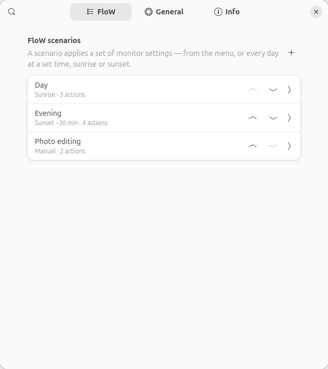
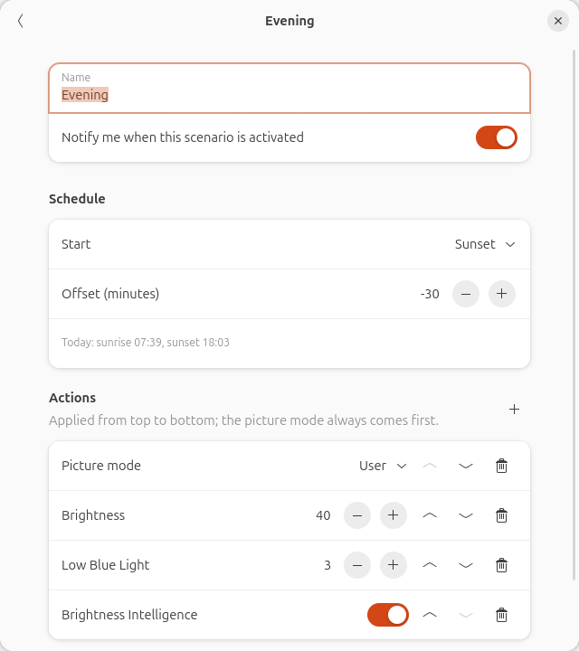
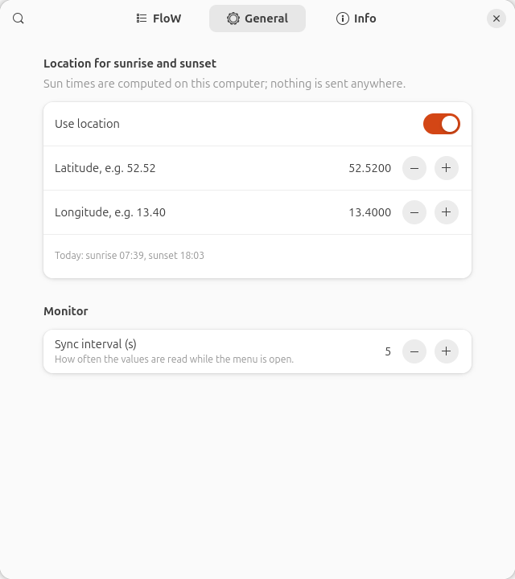

# BenQ Monitor Control for GNOME

A GNOME Shell extension that controls the **BenQ MA320U** over DDC/CI from the top bar:
picture modes, brightness, volume, input source, Low Blue Light, Brightness Intelligence,
and **FloW scenarios**, which are named sets of monitor settings that apply by hand or on
a daily schedule (fixed time, sunrise or sunset).

**Why this exists:** the MA320U's on-screen menu only offers brightness, input and volume.
Its picture modes and eye-care settings can be reached only through BenQ's *Display Pilot 2*
software. Display Pilot 2 has a Linux build, but it does not support the MA series
(`monitor does not support: "MA320U"`). This extension provides that control on GNOME.

It is the GNOME port of [benq-monitor-control](https://github.com/chrisOTM/benq-monitor-control),
a tray app for KDE Plasma. Both use the same VCP map, safety rules and scenario format.

**Status:** v0.1.0. Tested on one MA320U (USB-C) with GNOME Shell 50 on Wayland
(Ubuntu 26.04).

  
  

## Features

### Top-bar menu

| Section | What it does |
|---|---|
| Status | Connection state, I²C bus and firmware level; *Detect again* when the monitor is not found. |
| Picture mode | Tux-Book (BenQ: M-Book), sRGB, Display P3, Cinema, Game, User. Shows *HDR signal active* when the monitor receives HDR. |
| Picture & sound | Brightness (0–100) and volume (0–50) sliders. |
| Eye care | Low Blue Light (Off, 1–5) and Brightness Intelligence. |
| Input | USB-C, HDMI 1, HDMI 2. Switching away asks for confirmation, because this computer loses control of the monitor until you switch back. |
| FloW | The scenarios; the active one is ticked and the header shows until when it applies. |

The menu stays open while you change things, so you see each change take effect. Controls
the monitor refuses in the current picture mode are greyed out. Low Blue Light, for example,
is locked in sRGB and Display P3, and an HDR signal locks picture mode, brightness and the
eye-care settings. If the monitor rejects a write, the control snaps back and stays locked
in that mode for the rest of the session.

**Brightness keys:** the laptop's Fn brightness keys also change the monitor (steps of 5 %,
with GNOME's on-screen display). It works while the laptop screen is off, too. Shift + key
changes only the screen under the pointer. Turn it off in the preferences
(*Brightness keys control the monitor*); GNOME's own keys then work as before.

**Brightness Intelligence** is BenQ's automatic brightness. The MA320U has a built-in
ambient light sensor and adjusts its brightness to the room light over the day. While it is
on, the monitor may override the brightness slider; the slider follows the next time the
menu opens.

**Night Light hint:** GNOME Night Light warms the picture before it leaves the computer, and
the monitor's Low Blue Light filters blue inside the monitor. While both are active they add
up, and the menu says so.

### FloW scenarios

Create scenarios in the preferences (*Settings…* in the menu, or the *Extensions* app).

- **Actions:** picture mode, brightness, volume, Low Blue Light, Brightness Intelligence and
  *open application*. They are applied from top to bottom, except the picture mode, which
  always comes first because it decides which other settings the monitor accepts.
- **Schedule:** *Manual*, a daily *time*, or *sunrise*/*sunset* with an offset of ±120 minutes.
  Sun times are computed on the computer (NOAA algorithm) from the coordinates you enter
  under *General*. Nothing is looked up online.
- **Semantics:** a scheduled scenario stays active until the next scheduled start, so *Day at
  sunrise* plus *Evening at sunset* covers the whole day. Picking a scenario in the menu
  applies it until the next scheduled start.
- **Re-apply:** after login, after resume from suspend and after a clock jump, the scenario
  that should be active now is applied again, without opening applications and without a
  notification. Schedules also fire while the screen is locked.
- **Notification** (optional) when a scenario is activated, including how many actions the
  monitor refused (e.g. Low Blue Light in sRGB).

## Requirements

- GNOME Shell 50 on Wayland.
- [`ddcutil`](https://www.ddcutil.com/) 2.x, and read/write access to `/dev/i2c-*`. On Ubuntu,
  `sudo apt install ddcutil` sets this up through ddcutil's udev rule. Check with
  `ddcutil detect`: it should list *BenQ MA320U*.
- A BenQ MA320U. Other monitors are not supported. The model description in
  [`extension/lib/model.js`](extension/lib/model.js) is plain data, so other BenQ models
  can be added once their VCP codes are known.

## Install

From source:

    git clone https://github.com/chrisOTM/gnome-benq-monitor-control.git
    cd gnome-benq-monitor-control
    ./install.sh

Or as a zip: `./pack.sh` builds `dist/…shell-extension.zip`; install it with
`gnome-extensions install --force dist/*.zip`.

GNOME on Wayland loads new extensions only at login, so **log out and back in once**. Then
enable *BenQ Monitor Control* in the *Extensions* app or with

    gnome-extensions enable benq-monitor-control@chrisotm.github.io

The monitor icon appears in the top bar. It is dimmed while the monitor is not reachable.

## How it works

- **Talking to the monitor:** the extension starts the `ddcutil` command-line tool
  asynchronously, so the shell never waits on the I²C bus. All calls go through one queue,
  so two commands never overlap on the bus. A slider that is dragged sends only its
  latest value.
- **Finding the monitor:** by model name (`ddcutil detect`), never by bus number. It is
  detected again 3 s and 10 s after a display change (hotplug, input switched back) and
  every 60 s while it is not reachable.
- **Reading:** when the menu opens, and then every *sync interval* seconds (default 5) while
  it stays open. Nothing is polled while the menu is closed, so the extension costs nothing
  in the background on battery.
- **Storage:** GSettings (`org.gnome.shell.extensions.benq-monitor-control`). The `scenarios`
  key holds the same JSON as the KDE app's `scenarios.json`.
- **Privacy:** no network access, no account, no telemetry.

## Safety

The extension writes only six VCP codes:

| Control | VCP | Values |
|---|---|---|
| Picture mode | 0xDC | 0x0F Tux-Book (M-Book), 0x0A sRGB, 0x22 Display P3, 0x32 Cinema, 0x28 Game, 0x12 User; 0x23/0x27 HDR (read-only) |
| Brightness | 0x10 | 0–100 |
| Volume | 0x62 | 0–50 |
| Input | 0x60 | 0x13 USB-C, 0x11 HDMI 1, 0x12 HDMI 2 |
| Low Blue Light | 0x19 | 0 off, 1–5 |
| Brightness Intelligence | 0x81 | 0 off, 1 on (a read value of 2 also means on) |

Every write except the input switch is verified by ddcutil reading the value back.
Manufacturer-specific codes whose meaning is unknown are never written, and settings end up
in the monitor exactly as if BenQ's own software had changed them. The VCP map comes from
the KDE project's analysis of the publicly downloadable Display Pilot 2 packages and from
live tests. No BenQ code, binaries or resources are included. Use at your own risk; see the
licence.

## Troubleshooting

| Symptom | What to check |
|---|---|
| *Monitor not reachable* | `ddcutil detect` must list *BenQ MA320U*. The monitor must show this computer's input and must not be in standby. |
| *No permission for /dev/i2c-\** | Install ddcutil's udev rule (the Ubuntu package does) or add your user to the `i2c` group, then log in again. |
| A control is greyed out | The monitor does not accept it in the current picture mode (or with an HDR signal). |
| Scenario at sunrise/sunset never fires | Set and enable a location under *General*. In polar day or night there is no sunrise or sunset that day. |

Logs: `journalctl -b /usr/bin/gnome-shell | grep benq-monitor-control`

## Development

    gjs -m tests/run.js     # unit tests: parsers, session, scheduler, sun times, scenarios
    ./install.sh            # copy to ~/.local/share/gnome-shell/extensions, then log out/in

| Path | Content |
|---|---|
| `extension/lib/` | Logic without shell imports (GLib/Gio only), so it runs under plain `gjs`: ddcutil runner and parsers, monitor session and controller, FloW scheduler, sun times, translations. |
| `extension/ui/indicator.js` | The top-bar button and menu. |
| `extension/extension.js` | Wiring: hotplug, resume, lock screen, notifications. |
| `extension/prefs.js` | Preferences (libadwaita). |
| `docs/specs/` | Design notes, including the differences from the KDE app. |

The UI follows the session language: German for `de*` locales, English otherwise. The
translations are lookup tables in `extension/lib/i18n-de.js`.

## Trademarks

Not affiliated with, endorsed or sponsored by BenQ. BenQ, MA320U, Display Pilot, FloW and
Brightness Intelligence are trademarks of BenQ Corporation, used here only to describe
compatibility. “Tux-Book” is this project's name for the monitor's M-Book mode.

## License

MIT, see [LICENSE](LICENSE).
